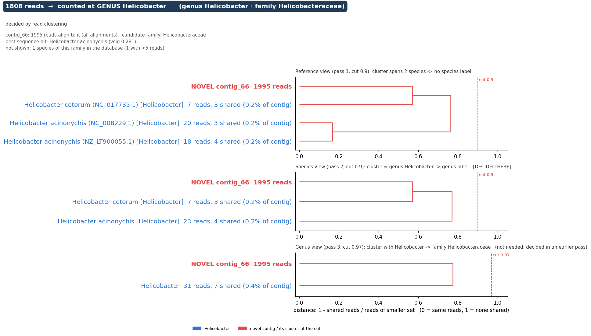

# MADRe

<p align="center">
  
</p>

Strain-level metagenomic classification with Metagenome Assembly driven Database Reduction, including organisms that are missing from the database.

+ [What MADRe does](#what-madre-does)
+ [What is new in MADRe 2](#what-is-new-in-madre-2)
+ [Installation](#installation)
+ [Preparing a database](#preparing-a-database)
+ [Running MADRe](#running-madre)
+ [Output files](#output-files)
+ [Toy example](#toy-example)
+ [MADRe 1](#madre-1)
+ [Citing MADRe](#citing-madre)

## What MADRe does

MADRe classifies long metagenomic reads (ONT, PacBio HiFi) against a large reference database that may hold many strains per species. It does not map every read to every genome. Instead it first assembles the reads, maps the contigs to the database and keeps only the genomes the contigs support (**assembly-driven database reduction**). The reads are then mapped to this much smaller database and assigned to strains.

Real samples often contain organisms that are not in the database at all. MADRe 2 recognises the contigs of such organisms, keeps their reads on those contigs instead of forcing them onto the closest known genome, and places them in the taxonomy as far as the database allows (e.g. "a new species of genus X").

The pipeline:

1. **Assembly** of the reads (metaFlye for ONT, metaMDBG for HiFi; Myloasm optional), or your own contigs with `--assembly`.
2. **Contigs mapped** to the full reference database (minimap2).
3. **Collapsed strains** per contig (HairSplitter).
4. **Database reduction and contig classification.** Each contig is labelled KNOWN, UNCERTAIN or NOVEL_CANDIDATE by how well it is covered by database genomes. The supported genomes are selected as whole genomes (all their chromosomes and plasmids).
5. **Novel contigs grouped** into putative organisms by sequence similarity and assembly-graph links.
6. **Extended database** = selected genomes + UNCERTAIN and novel contigs (+ an optional host genome).
7. **Reads mapped** to the extended database.
8. **StrainRefine:** novel contigs are placed in the taxonomy (species, genus or family, or left unplaced), reads are assigned to strains, and near-identical strains are clustered.
9. **Abundances:** genome copies per strain and species, a species summary and a taxonomic profile.

## What is new in MADRe 2

- **Organisms missing from the database** are detected (contig classification + novel groups) and **placed in the taxonomy**.
- **StrainRefine replaces MADRe 1's read classification step.** Reads are assigned to strains from their mapping profiles, and strains the reads cannot tell apart are clustered, which removes many false-positive strains. MADRe 2 builds on [StrainRefine](https://github.com/lbcb-sci/StrainRefine) ([Lipovac et al., Journal of Computational Biology, 2026](https://journals.sagepub.com/doi/10.1177/15578666261485334)) and extends it with novel contigs and their placement in the taxonomy.
- **Whole-genome database reduction:** a genome enters the reduced database with all its sequences.
- **Abundance as genome copies**, robust to high-copy plasmids (median depth over the genome's sequences), also for novel groups.
- **Host separation:** with `--host-reference`, host reads are reported as host and left out of the microbial abundances.
- **Your own contigs** can be used instead of the assembly step (`--assembly`).
- **Simpler database setup:** the species of every reference is read from the taxonomy (`--nodes`); `madre-prepare-database` builds the reference files from genome FASTAs or an existing combined FASTA.

MADRe 2 keeps the command name `madre`, but its options and outputs differ from MADRe 1 (see [MADRe 1](#madre-1)).

## Installation

From source, with the dependencies from conda:

```bash
git clone https://github.com/lbcb-sci/MADRe
cd MADRe
conda env create -f environment.yml
conda activate madre
pip install --no-deps .
```

This installs the commands `madre` (the pipeline), `madre-prepare-database`, `database-reduction` and `strain-refine` (single steps).

Dependencies: Python ≥ 3.8 with numpy, scipy, scikit-learn and matplotlib; minimap2 ≥ 2.28, metaFlye, metaMDBG, HairSplitter and seqkit (Myloasm optional). All are in `environment.yml`.

## Preparing a database

MADRe needs, besides the reads:

| input | what it is | given as |
|---|---|---|
| reference FASTA | all reference genomes; every header carries the taxid (`>|562|NC_000913.3`) | `predefined_db` in `config.ini` |
| reference genome map | every sequence → its genome, and the genome's total length | `--reference_genome_map` |
| taxonomy | `nodes.dmp` and `names.dmp` (NCBI format, e.g. NCBI or GTDB) | `--nodes`, `--names` |

`madre-prepare-database` builds the first two, either from a folder with one FASTA per genome (e.g. NCBI downloads) or from an existing combined FASTA with taxids in its headers (e.g. a Kraken2 library):

```bash
# a folder of genome FASTAs + NCBI's assembly_summary.txt for their taxids
madre-prepare-database genomes --genomes my_genomes/ --assembly-summary assembly_summary.txt --nodes taxdump/nodes.dmp --out-prefix db/my_db

# an existing combined FASTA
madre-prepare-database fasta --fasta library.fna --nodes taxdump/nodes.dmp --out-prefix db/library
```

The NCBI taxonomy: `wget https://ftp.ncbi.nlm.nih.gov/pub/taxonomy/taxdump.tar.gz` and unpack it. Use the taxonomy version your database's taxids come from.

All details (genome grouping, taxid tables, checks): [DATABASE_PREPARATION.md](DATABASE_PREPARATION.md).

## Running MADRe

`config.ini` gives the tools and the database (use absolute paths):

```ini
[PATHS]
metaflye = flye
metaMDBG = metaMDBG
minimap = minimap2
hairsplitter = hairsplitter.py
myloasm = myloasm

[DATABASE]
predefined_db = /path/to/db/my_db.fna.gz
```

`seqkit` must be on the `PATH`.

```bash
madre --out-folder results/sample1 \
      --reads sample1.fastq.gz \
      --reads_flag ont \
      --threads 64 \
      --config config.ini \
      --reference_genome_map /path/to/db/my_db.reference_genome_map.tsv \
      --nodes taxdump/nodes.dmp \
      --names taxdump/names.dmp
```

Frequently used options (all: `madre --help`):

| option | what it does |
|---|---|
| `--reads_flag ont\|hifi\|pacbio` | read technology (default `ont`). ONT is assembled with metaFlye, HiFi with metaMDBG. PacBio CLR reads need `--assembly`. |
| `--use-metamdbg` / `--use-myloasm` | assemble ONT reads with metaMDBG, or ONT/HiFi reads with Myloasm |
| `--assembly contigs.fasta` | use these contigs instead of assembling the reads (without an assembly graph, novel contigs are grouped by similarity only) |
| `--host-reference host.fna --host-name human` | separate host reads (e.g. human T2T-CHM13) |
| `--min-abundance X` | leave species below X% out of the taxonomic profile (the complete profile is kept as `strainrefine_taxonomic_profile.all_species.tsv`); default 0 (off) |
| `--no-novel-placement` | do not place novel contigs in the taxonomy |
| `--placement-report` | draw a figure of the placement of every novel contig with a candidate family (`novel_placement_report/`, see [Placement figures](#placement-figures)); off by default, since with thousands of novel contigs drawing takes hours |
| `--keep-reduced-db` | keep `reduced_db.fa` (by default only the list `reduced_db_refs.txt` is kept) |
| `--threads N` | threads for all tools (default 32) |
| `-F` | rerun steps whose outputs already exist (by default finished steps are skipped, so an interrupted run can be resumed) |

## Output files

In `--out-folder`:

| file | content |
|---|---|
| `strainrefine_taxonomic_profile.tsv` | taxonomic profile: one row per taxon (all ranks) and per novel group, with read count, genome copies (`genome_equivalent_signal`) and relative abundance (%) |
| `strainrefine_species_or_group_summary.tsv` | one row per species or novel group: reads, bases, genome copies, relative abundance and its references |
| `strainrefine_reference_summary.tsv` | one row per strain (genome) or contig with reads: read count, bases, length, depth, horizontal coverage. For a contig, `best_database_hit` is the genome of its best database match and `best_database_hit_vcig` the contig's novelty score (0–1, see `contig_classification.tsv`); a low value means the contig is hardly similar to the database, so this is a label, not an identification |
| `read_classification.out` | `read_id : reference` for every assigned read (a database sequence, a contig of a novel organism, or the host) |
| `contig_classification.tsv` | every contig: KNOWN / UNCERTAIN / NOVEL_CANDIDATE, its novelty score (`vcig_norm`: the fraction of the contig covered by alignments to database genomes, weighted by their identity) and best database hit |
| `novel_groups.tsv` | the novel contigs and the putative organisms (groups) they form |
| `novel_placement.tsv` | where each novel contig was placed in the taxonomy (rank, taxon, and why) |
| `novel_placement_report/` | only with `--placement-report`: one figure per novel contig with a candidate family, and the numbers behind them |
| `strainrefine_clustering/` | clusters of indistinguishable strains and their representatives |
| `reduced_db_refs.txt` | the database sequences selected by the reduction |

Novel organisms appear in the profile and summaries as `NOVEL_COMPARE_…` (unplaced groups), or under the taxon they were placed in.

The other files in the output folder are intermediate results of the pipeline steps; all of them are described in the [toy example](toy_example/Tutorial.md#everything-in-the-output-folder).

### Placement figures

With `--placement-report`, MADRe draws a figure for every novel contig with a candidate family, in `novel_placement_report/contig_<id>.png`. It shows how the contig was placed in the taxonomy:

- **Header:** where the contig's reads are counted (e.g. "counted at GENUS *Helicobacter*", or "NOT COUNTED at any rank" for a contig that stays an unplaced novel group), and which comparison decided it.
- **Three panels**, one per comparison: the contig against its nearest database strains, against their species, and against their genera. Each is a dendrogram of read sharing: the distance between two entries is 1 − shared reads / reads of the smaller one (0 = the same reads, 1 = no shared reads). A contig that joins a cluster below the cut (red dashed line) gets the taxon of that cluster; the panel that decided is marked "DECIDED HERE".
- The numbers behind the figures are in `novel_placement_report/novel_contig_neighbours.tsv`, and every decision is in `novel_placement.tsv`.

Example: a contig of *Helicobacter pylori*, simulated with *H. pylori* removed from the database. Its reads do not cluster with any single species of the database (top), but its cluster at the species level contains only *Helicobacter* species (middle), so it is placed in genus *Helicobacter*:

<p align="center">
  
</p>

## Toy example

[toy_example/Tutorial.md](toy_example/Tutorial.md) runs MADRe on a small simulated dataset twice: with a database that contains all its species, and with one species removed, to show how MADRe reports an organism that is missing from the database.

## MADRe 1

MADRe 1 remains available on the branch [`madre1`](https://github.com/lbcb-sci/MADRe/tree/madre1) and as release [v0.0.5](https://github.com/lbcb-sci/MADRe/releases/tag/v0.0.5) (Bioconda: `conda install bioconda::madre=0.0.5`).

## Citing MADRe

GigaScience - https://doi.org/10.1093/gigascience/giag030:
```
Lipovac, J., Šikić, M., Vicedomini, R., & Križanović, K. (2026). MADRe: Strain-level metagenomic classification through assembly-driven database reduction. GigaScience, 15, giag030. https://doi.org/10.1093/gigascience/giag030
```

StrainRefine, used for read assignment in MADRe 2 - https://journals.sagepub.com/doi/10.1177/15578666261485334:
```
Lipovac, J., Angevin, L., & Križanović, K. (2026). Using Mapping-Profiles to Refine Strain-Level Metagenomic Classification. Journal of Computational Biology. https://doi.org/10.1177/15578666261485334
```
